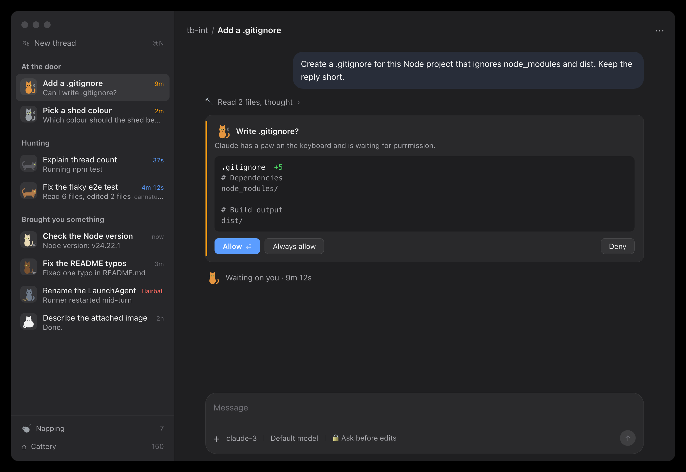
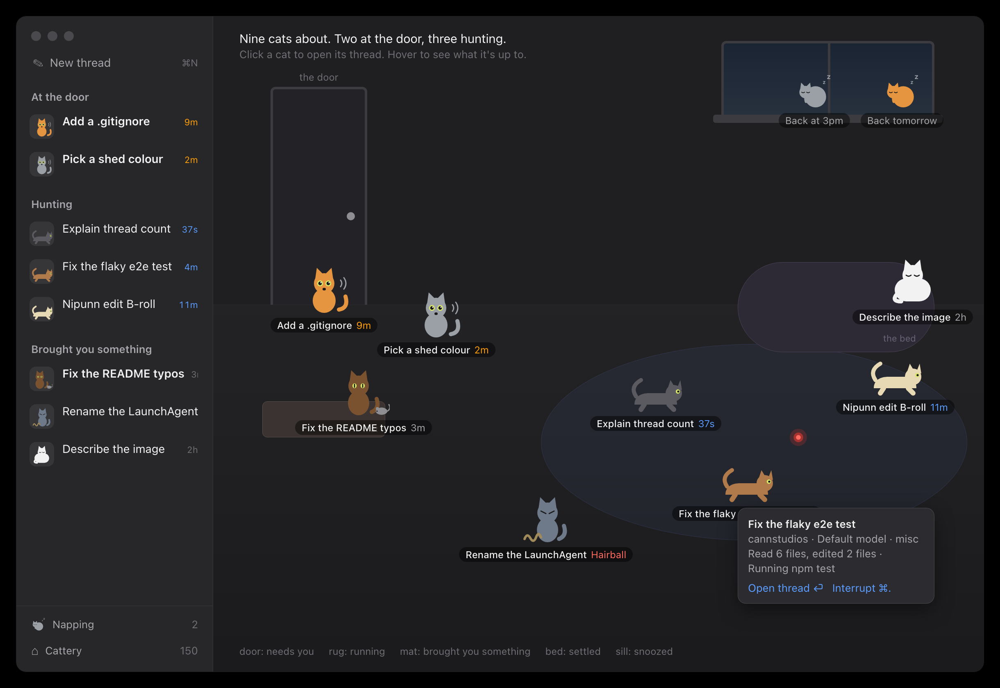
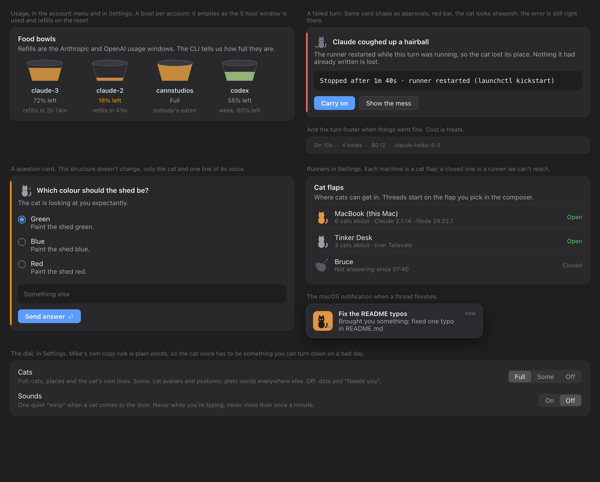
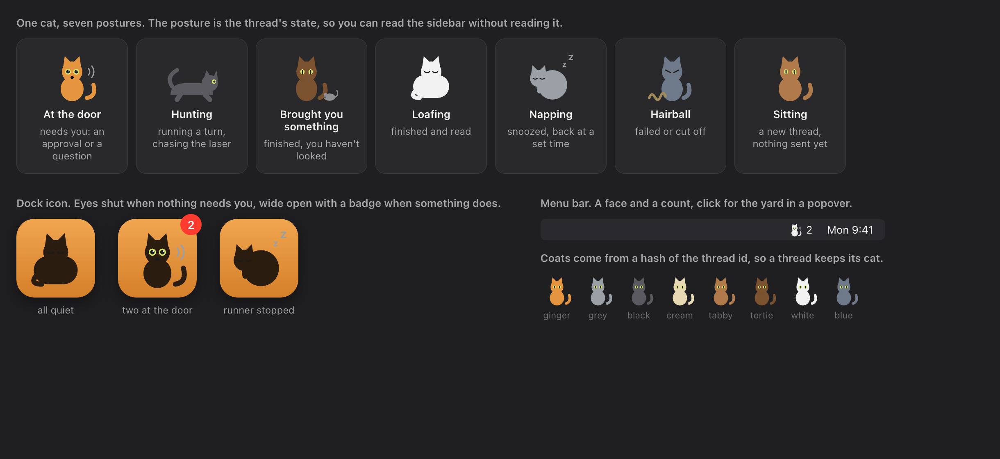

# Cat Herder: design concepts (2026-10-27)

Mike isn't sold on "Threadbare" and said he'd like the app to be fun and
humorous to work with, not just a plainer T3. This is a first pass at
what a "Cat Herder" version would look like: the agents are cats, you're
the one trying to herd them, and the app's state is read as what the
cats are doing. Nothing here is built. The mockups are HTML in this
folder, rendered with `render.sh` (uses the Playwright Chromium already
on the Mac, no install).

The rule that keeps it usable: every cat thing maps one-to-one onto a
thing the app already has, and the structure of each screen doesn't
change. The sidebar is still the sidebar, the approval card still has
Allow, Always allow and Deny. The cats are a layer on top, and there's a
dial in Settings to turn them down or off (see "The dial").

## The idea in one screen

What changed against the current app:

- **The coloured status dot becomes a cat.** Each thread gets a cat,
  coat colour hashed from the thread id so it keeps its cat for life. The
  cat's posture is the thread's state, so the sidebar can be read at a
  glance without reading it. The postures are in the sheet below.
- **Sections are named for what the cats are doing.** "Needs you" is
  "At the door" (sat at the door, staring, meowing). "Running" is
  "Hunting". "Inbox" is "Brought you something", because a finished
  thread is a cat dropping a mouse on the mat. Snoozed is "Napping",
  Archive is "Cattery", Trash is "Litter tray".
- **Cards keep their shape and gain one line of cat voice.** The
  approval card's title is still the plain question ("Write
  .gitignore?"), the buttons are unchanged, and the subtitle is the
  cat's line: "Claude has a paw on the keyboard and is waiting for
  purrmission." Those lines are canned and rotate; nothing is generated.
- **The working line gets the cat too.** "Hunting for 37s" with the
  thread's cat instead of a spinner; while waiting on you, the cat sits
  and the tail flicks.

## The yard

The hero piece, and the only genuinely new screen. When no thread is
selected (and in a menu bar popover) the pane is a room with every live
thread in it as a cat. Where a cat is tells you its state: at the door
needing you, on the rug chasing the laser (running), on the mat with
what it brought you (finished, unread), on the bed (finished and read),
on the window sill asleep (snoozed). Click a cat to open its thread,
hover for what it's doing, ⌘. to interrupt it.

Cats would move: hunting cats pounce around the laser dot, a cat walks
to the door when it needs you, a finished cat walks to the mat and drops
the mouse. Small, slow, and nothing moves while you're typing in a
composer. This is the piece Mike would show people.

## The smaller pieces

- **Food bowls** are per-account usage. The bowl empties as the 5 hour
  window is used and refills on the reset. This is the Token Stats
  part of step 4 in a form you can read from across the room: a nearly
  empty bowl is why a cat is slow, and a full bowl is an account with
  nothing in it. Cost in the turn footer is "treats".
- **Hairball** is a failed or cut-off turn. Same card as an approval
  with a red bar; the cat looks sheepish, the real error is still in a
  monospaced block, and the primary action is "Carry on" (resume the
  session), with "Show the mess" for the full output.
- **Cat flaps** are runners. Each machine is a flap; a closed flap is a
  runner the app can't reach. "Open a flap on Tinker Desk" is how step 6
  reads in this world.
- **Question cards** change only the cat and one line ("The cat is
  looking at you expectantly."). The options, the free text field and
  Send answer stay exactly as they are.
- **Notifications** say "Brought you something:" and the first line of
  the answer, with the cat and its mouse as the icon.

## Icons and postures

The dock icon is one cat whose eyes are shut when nothing needs you and
wide open with a badge when something does; curled up asleep means the
runner is stopped. The menu bar item is a face and a count, click for
the yard as a popover.

## The dial

Mike's own copy rule for this app is plain words, and the cat voice is
the kind of thing that's funny on Monday and grating on a bad Thursday.
So Settings gets a three-way "Cats" setting:

| Setting | What you get |
|---|---|
| Full | Cats, the place names (door, rug, mat, bed, sill, cattery, litter tray), the cat's canned lines on cards, treats and food bowls, the yard. |
| Some | Cat avatars and postures in the sidebar and on cards, dock and menu bar cat. Plain words everywhere else ("Needs you", "Running", "Inbox", "Failed"). |
| Off | The app as it is today: dots, words, no cats. |

Sounds are a separate switch, off by default: one quiet "mrrp" when a
cat comes to the door, never while you're typing, never more than once
a minute. No purring while running, it would be irritating inside ten
minutes.

## Vocabulary

| App thing | Cat thing |
|---|---|
| Thread | Cat |
| Needs you (approval or question) | At the door |
| Running | Hunting (chasing the laser) |
| Finished, unread | Brought you something (on the mat) |
| Finished, read | Loafing (on the bed) |
| Snoozed | Napping (on the sill) |
| Archive | Cattery |
| Trash | Litter tray |
| Failed or cut off turn | Hairball |
| Approval prompt | Purrmission |
| Everything running at once | Zoomies |
| Runner / machine | Cat flap |
| Account usage window | Food bowl |
| Cost | Treats |
| New thread | New cat (the sidebar row stays "New thread ⌘N") |
| Interrupt | Clap (⌘. stays) |

## What it would cost to build

Rough order, cheapest first. All of it is app-side; the runner and
protocol don't change except for usage (step 4 already plans that).

1. **Sprites and the sidebar** (a day). One SwiftUI `CatView` that draws
   the seven postures from paths (the SVG in `cats.js` is the source),
   coat from the thread id hash, used in place of the status dot. Section
   names and the dial. This alone makes the app feel different.
2. **Cards and copy** (half a day). The cat and its line on approval,
   question and error cards; "Brought you something" notifications; the
   dock icon states; treats in the footer.
3. **Food bowls** (comes with step 4's usage work). The bowl is a view
   over the numbers step 4 already has to fetch.
4. **The yard, static** (a day). A pane that lays cats out by state with
   labels and hover; click to select. Menu bar popover reuses it.
5. **The yard, moving** (two or three days). Cats walk between places on
   state changes and hunters pounce. Needs a cheap timer-driven layout
   that pauses when a composer has focus and when the window isn't
   visible, and the memory bar (200 MB) still has to hold.

The sprite style in the mockups is deliberately flat and simple so it
can be drawn with SwiftUI paths rather than image assets, and so it
holds up at 26 pt in a sidebar row. A nicer hand-drawn set could replace
it later without touching the code.

## Open questions for Mike

- Is "Cat Herder" the name, or is this the personality under another
  name (Bobbin, Kelpie)? The vocabulary works either way.
- Does Full mode rename the sections, or is Some the right default and
  Full is the yard plus the lines?
- Names for runners: "cat flap" was the best of the options tried; "the
  neighbour's house" for Tinker Desk was funnier and worse.
